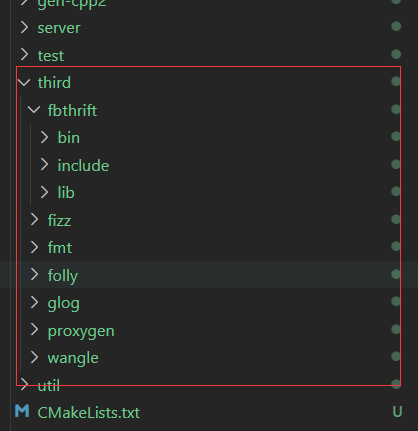
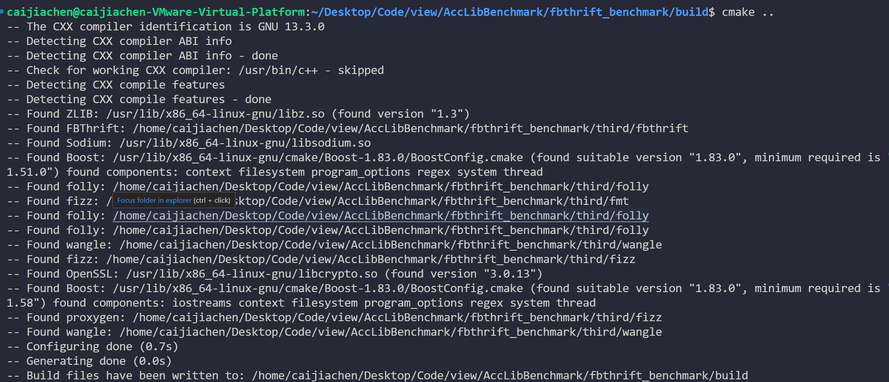
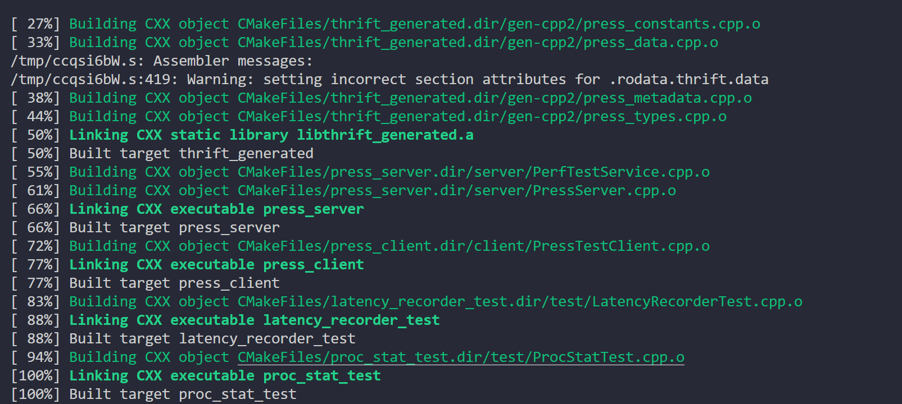
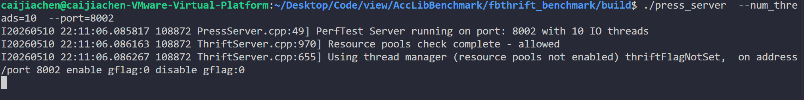
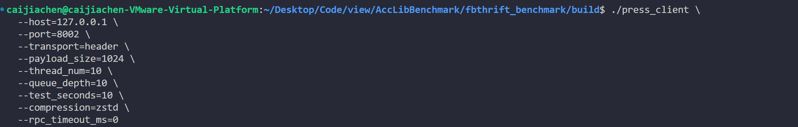
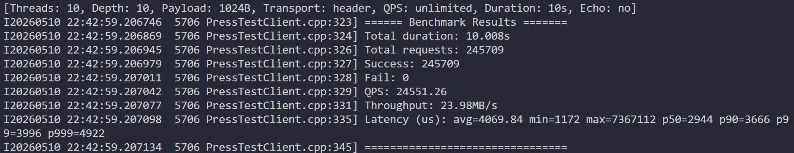

# fbthrift Echo 压测示例（C++）

这是一个基于 Facebook Thrift (fbthrift) 的简单 Echo RPC 压测工具示例，包含：

- Thrift IDL 定义
- fbthrift 服务端（press_server）
- fbthrift 压测客户端（press_client）
- 支持 Rocket / Header 两种传输协议
- 支持 zlib / zstd / none 压缩
- 支持多线程、队列深度、Payload 扫描等压测模式

---

## 一、环境依赖

- C++17 或更高
- fbthrift
- fizz
- fmt
- wangle
- folly
- glog
- proxygen

 依赖库安装到 third 目录下




## 二、代码生成

使用 thrift1 生成 C++（mstch_cpp2）代码：

thrift1 --gen mstch_cpp2 press.thrift

## 三、编译构建

```bash
  mkdir build
  cd build
  cmake ..
  make -j
```





## 四、服务端启动

```bash

--port	8002	服务端监听的 TCP 端口号，客户端需要通过该端口连接。
--num_threads	5	服务端处理请求的 I/O 和 CPU 工作线程数量。这里设置为 5 个线程，用于并发处理客户端请求。


./press_server  --num_threads=5  --port=8002
```




## 五、客户端压测

```bash

--host	127.0.0.1	服务端 IP 地址，本地回环地址。
--port	8002	服务端监听端口，与服务端启动时的 --port 一致。
--transport	header	传输协议，使用 Header 协议（另一种可选值为 rocket）。
--payload_size	1024	每个请求的 Payload 大小（字节）。这里固定为 1024 字节。
--thread_num	10	并发线程数，同时有 10 个线程发送请求。
--queue_depth	10	每个线程允许的最大 in-flight 请求数（即每个线程可以同时发起的未完成请求数量）。这里每个线程可同时保持 10 个请求未完成，总并发请求数 = 线程数 × 队列深度 = 10 × 10 = 100。
--test_seconds	10	压测持续时间（秒），运行 10 秒后自动停止。
--compression	zstd	压缩算法，使用 Zstandard 压缩 Payload（可选 none / zlib / zstd）。
--rpc_timeout_ms	0	RPC 超时时间（毫秒），0 表示无超时限制。

./press_client \
  --host=127.0.0.1 \
  --port=8002 \
  --transport=header \
  --payload_size=1024 \
  --thread_num=10 \
  --queue_depth=10 \
  --test_seconds=10 \
  --compression=zstd \
  --rpc_timeout_ms=0

```



## 六、示例压测结果


